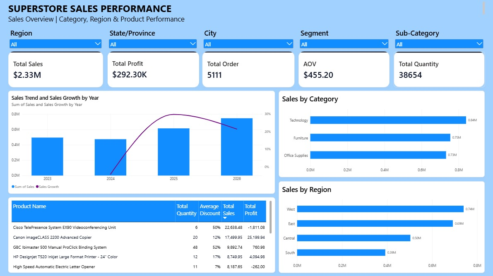

# Superstore Sales Analysis

## Project Overview

This project focuses on analyzing sales performance using the Superstore dataset.

The analysis aims to understand sales trends, profitability, customer orders, product performance, and regional sales performance.

This project follows a data analytics workflow, starting with data exploration and analysis using Microsoft Excel, followed by SQL analysis using PostgreSQL, and data visualization using Microsoft Power BI.

The goal is to transform business data into meaningful insights that can help understand sales performance and support data-driven business decisions.

## Project Objectives

- Explore and understand the Superstore sales dataset.
- Analyze overall sales and profit performance.
- Identify sales trends and growth patterns over time.
- Compare sales performance across categories and regions.
- Identify top-performing and low-performing products.
- Evaluate the relationship between discounts and profitability.
- Present analytical findings through an interactive Power BI dashboard.

## Tools & Technologies

| Tool | Purpose |
|---|---|
| Microsoft Excel | Data exploration, analysis, and dashboard creation |
| PostgreSQL | Database management and SQL-based exploratory analysis |
| Microsoft Power BI | Data visualization, KPI creation, and interactive dashboard |
| GitHub | Project documentation and portfolio publication |

## Dataset

This project uses the Superstore Sales Dataset from Kaggle.

- Source: [Superstore Sales Dataset – Kaggle](https://www.kaggle.com/datasets/himanshuuike/superstore-sales-dataset)
- License: CC0 1.0 Universal (as listed on the dataset page)
- Format: CSV

The raw dataset is not included in this repository. Please download it from the original source before reproducing the analysis.

## Project Workflow

### 1. Excel Analysis – Microsoft Excel

Microsoft Excel was used to explore the dataset and perform initial sales analysis.

The analysis focuses on:

- Understanding the dataset structure.
- Exploring sales and profit performance.
- Analyzing sales trends over time.
- Comparing sales across categories and regions.
- Identifying important business patterns.

### 2. SQL Analysis – PostgreSQL

PostgreSQL was used to perform exploratory and business-oriented analysis through SQL queries.

The SQL analysis covers:

**Sales Analysis**

- Calculating total sales and profit.
- Analyzing sales performance by year.
- Comparing sales across categories and regions.
- Identifying sales growth patterns.

**Product Analysis**

- Identifying the top 10 products by sales.
- Identifying products with the lowest profit.
- Comparing product sales and profitability.

**Customer Analysis**

- Analyzing customer orders.
- Exploring customer purchasing patterns.
- Identifying customer-related data relationships.

**Profitability and Discount Analysis**

- Comparing sales and profit performance.
- Analyzing product discounts and profitability.
- Identifying products with negative profit.

**Data Relationship Analysis**

- Using INNER JOIN and LEFT JOIN.
- Identifying matching and unmatched customer records.

### 3. Data Visualization – Microsoft Power BI

An interactive dashboard was developed using Microsoft Power BI to present the results of the analysis.

The dashboard includes:

- Data preparation using Power Query.
- Data analysis using DAX measures.
- KPI cards to display key business metrics.
- Interactive filters to explore sales performance.
- Charts to compare sales trends, categories, and regions.
- A product performance table.

## Dashboard Preview



## Key Performance Indicators (KPIs)

The dashboard includes the following KPIs:

- Total Sales
- Total Profit
- Total Orders
- Average Order Value (AOV)
- Total Quantity

## Key Business Insights

Based on the completed dashboard:

### 1. Sales Performance

Sales decreased by 4.26% in 2024 compared to 2023. However, sales increased by 29.80% in 2025 and continued to grow by 21.44% in 2026 compared to 2025.

The highest annual sales during the analyzed period occurred in 2026, with total sales of $745,574.44.

This shows that sales performance did not always increase every year. The decline in 2024 needs further analysis to understand the factors related to the decrease in sales.

### 2. Category Performance

Technology had the highest total sales, with $839,893.35, while Furniture had the lowest total sales, with $754,747.94.

The sales difference between these two categories was $85,145.41.

This shows that Technology performed better in total sales than Furniture. Further analysis is needed to understand the factors behind Technology's performance and identify opportunities to improve Furniture sales.

### 3. Regional Performance

The West region had the highest total sales, with $739,813.71, followed by:

- East: $691,828.25
- Central: $503,170.66
- South: $391,721.90

The South region had the lowest total sales among all regions.

This shows a difference in sales performance across regions. The West region can be used as a comparison to understand the factors that support higher sales performance.

### 4. Product Performance

Products with higher average discounts do not always generate the largest losses.

For example, Eureka Disposable had an average discount of 80% and a total profit of -$4.47. Meanwhile, Brother MFC had a lower average discount of 70%, but generated a larger loss of -$319.19.

This indicates that discount percentage alone may not explain product losses. Other factors, such as sales and quantity sold, also need to be analyzed.

### 5. Profitability Analysis

High sales do not always result in high profit.

Canon image had the highest total sales of $35,699.90 and also generated the highest total profit of $15,679.96.

However, Martin Yale had the second-highest total sales of $11,825.91, but generated a loss of -$1,232.56.

This shows that high sales do not always guarantee positive profit. Further analysis of quantity sold and discount levels is needed to understand the factors behind the loss.

## Recommendations

Based on the business insights, the following recommendations can be considered:

### 1. Improve Sales Performance

Analyze sales trends in 2024 by reviewing quantity sold, product discounts, and product performance.

This can help identify factors related to the sales decrease compared to 2023.

### 2. Improve Category Performance

Study the sales strategy and performance of the Technology category, including sales, quantity, discounts, and regional distribution.

Use these findings to identify opportunities to improve Furniture sales while maintaining the performance of Technology.

### 3. Improve Regional Performance

Use the West region as a reference to evaluate sales, quantity, discounts, categories, and sub-categories.

These findings can help identify opportunities to improve sales performance in the South, Central, and East regions.

### 4. Evaluate Product Discounts

Analyze product sales, quantity sold, and profit together with average discount levels.

This can help provide a better understanding of why some products generate larger losses than others.

### 5. Improve Product Profitability

Review quantity sold and discount levels for products with high sales but negative profit, such as Martin Yale.

This analysis can help identify opportunities to improve profitability without focusing only on increasing sales.

## Repository Structure

```text
superstore-sales-analysis/
│
├── README.md
│
├── excel/
│   └── 01_Superstore_Excel_Analysis.xlsx
│
├── sql/
│   └── 02_Superstore_SQL_Analysis.sql
│
├── power-bi/
│   └── 03_Superstore_Dashboard.pbix
│
└── images/
    └── dashboard-preview.png
```

## Skills Demonstrated

- Data Exploration
- Exploratory Data Analysis (EDA)
- Excel Analysis
- SQL Querying
- Data Aggregation
- SQL Joins (INNER JOIN and LEFT JOIN)
- Sales Performance Analysis
- Profitability Analysis
- Data Visualization
- Power BI Dashboard Development
- Business Insight Communication

## Author

Workscell

GitHub: https://github.com/workscell
